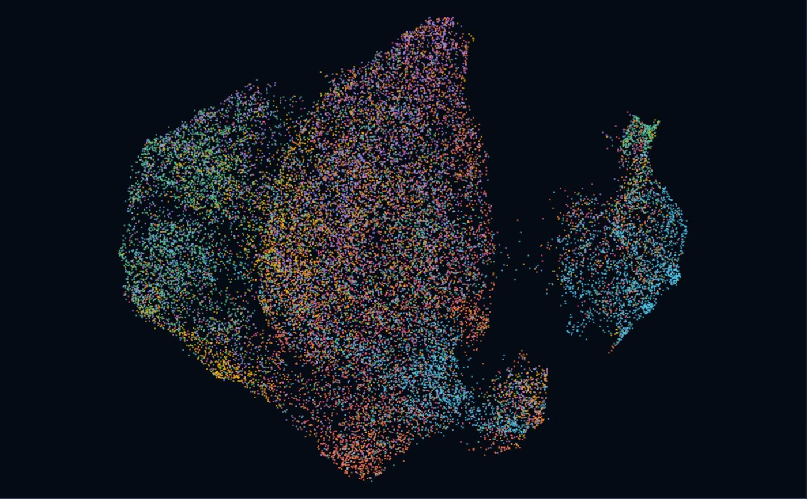

# Jeremy Renger: Portfolio

Interfaces that make dense technical data readable. Live: https://jeremyrenger.vercel.app



## Projects

### Spotify Audio Universe
26,159 real Spotify songs (one per title and artist) placed by nine audio features, projected with **UMAP** and **t-SNE** and rendered on canvas. Switching projection animates every track between the two maps; hover, search and pin a track to see its nearest neighbors.

- **Pipeline** ([`scripts/build_spotify_embedding.py`](scripts/build_spotify_embedding.py)): de-duplicate by title and artist, z-score, UMAP (n_neighbors 30, min_dist 0.15) and t-SNE (perplexity 40) with fixed seeds, writing a columnar JSON payload (2.4 MB, about 0.7 MB compressed).
- **Quality check:** trustworthiness at k=10 is 0.92 (UMAP) and 0.98 (t-SNE).
- **Finding:** only 38% of a song's 10 nearest neighbors in feature space share its playlist genre (chance is about 17%). EDM (52%), rap (44%) and rock (43%) form real regions; pop, latin and R&B (28-29%) blend.
- **Front end:** a single canvas pass with additive blending, device-pixel-ratio aware, with a 12 px spatial grid so hover lookup doesn't scan every point.
- **Data:** [TidyTuesday 2020-01-21 Spotify songs](https://github.com/rfordatascience/tidytuesday/tree/master/data/2020/2020-01-21), collected from the Spotify Web API. Not affiliated with Spotify.

### Frequency Atlas
An information-design study: neuromodulation research ranges from replicated trials to single small studies, so the atlas grades every intervention by evidence strength, sorts by it, and shows sources inline. It is not medical advice.

## Run locally

```bash
npm install
npm run dev
```

Rebuild the song map data:

```bash
pip install umap-learn scikit-learn pandas
curl -LO https://raw.githubusercontent.com/rfordatascience/tidytuesday/master/data/2020/2020-01-21/spotify_songs.csv
python scripts/build_spotify_embedding.py spotify_songs.csv public/data/spotify-universe.json
```

## Stack

TypeScript, React 19, Next.js 16 (App Router), canvas. Python, scikit-learn, umap-learn.
